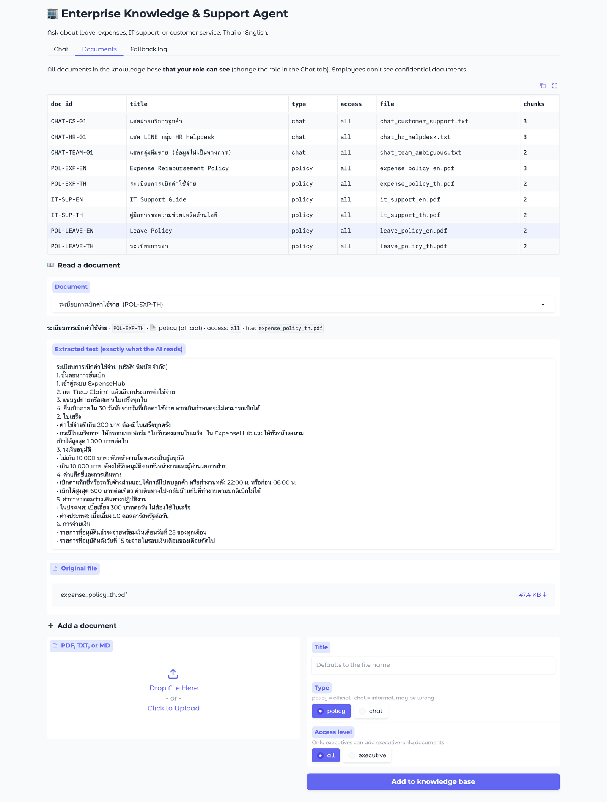
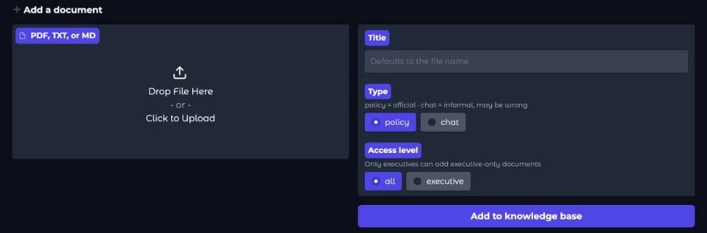

# Enterprise Knowledge & Support Agent (Mini RAG Prototype)

A small RAG agent that answers employee questions from company policy docs and chat logs, in **Thai and English**.
It handles slang and typos, refuses off-topic and prompt-injection requests, cites a source for every answer,
and falls back safely (and logs the question) when it isn't confident.

## Deliverables

| Task | File |
|---|---|
| 1 · Prototype | this repo (`app.py`, `src/agent/`), design notes in [DECISIONS.md](DECISIONS.md) |
| 2 · Production architecture (2 pages) | [docs/architecture.md](docs/architecture.md) · [PDF](docs/architecture.pdf) |
| 3 · Executive email (TH + EN) | [docs/exec-email.md](docs/exec-email.md) · [PDF](docs/exec-email.pdf) |

## How it works

```
question
  │
  ├─[1] Rule guardrail (regex, EN+TH)        ── injection? ──────────► polite refusal
  ├─[2] LLM triage: in-scope? + rewrite      ── off-topic/injection? ► polite refusal
  │                                          ── greeting? ──────────► short friendly reply
  │       ("เบิกเงิลได้มะ" → "เบิกเงินได้ไหม")
  ├─[3] Hybrid retrieval (BM25 + embeddings, RRF) with RBAC filter by role
  ├─[4] Gate 1: best similarity < threshold  ─────────────────────────► fallback + log
  ├─[5] LLM answer, must cite [S1], [S2] ...
  ├─[6] Gate 2: not answerable / low confidence / fake citation ──────► fallback + log
  ▼
answer + source list
```

**Architecture:** components and how they connect.


**Models and where they sit:** one LLM (Gemini via LiteLLM) for steps 2 and 5; search runs locally with pythainlp + BM25 and the `multilingual-e5-small` embedding model.


| Requirement | Where |
|---|---|
| Mock data: clear procedures + slang/typo chats | `data/docs/`: 7 **PDF** policies (EN/TH, 1 confidential) + 3 Thai chat exports (`.txt`), metadata in `catalog.yaml` |
| Guardrail / validation layer | `src/agent/guardrails.py` (rules) + triage prompt in `src/agent/prompts.py` |
| Source attribution | `[S#]` citations, checked in `guardrails.citations_are_valid` |
| Confidence threshold + fallback + logging | `src/agent/pipeline.py` gates 1 & 2 → `logs/unanswered.jsonl` |
| Evaluation | `eval/run_eval.py` + `eval/questions.jsonl` (28 cases) |
| Extra: browse + upload documents | **Documents** tab in the UI (`ingest.save_upload`) |

## Quickstart

Requires Python 3.11+.

```bash
git clone https://github.com/haritsirithep/enterprise-knowledge-agent.git && cd enterprise-knowledge-agent
python -m venv .venv && source .venv/bin/activate    # Windows: .venv\Scripts\activate
pip install -r requirements.txt

cp .env.example .env
# put your free Gemini key in .env  →  https://aistudio.google.com/apikey

python app.py            # open http://127.0.0.1:7860
```

Then open **http://127.0.0.1:7860** in your browser to use the web app. If you leave the API key field empty, it uses the free Gemini key from `.env`.

The first run downloads the embedding model (~470 MB, once).

## Switching the LLM

The model is any [LiteLLM](https://docs.litellm.ai/docs/providers) string. Change it in `.env` (`LLM_MODEL=...`) or type it in the UI dropdown.

| Provider | Example | Key in `.env` |
|---|---|---|
| Gemini (default, free tier) | `gemini/gemini-flash-lite-latest` | `GEMINI_API_KEY` |
| OpenAI | `openai/gpt-4o-mini` | `OPENAI_API_KEY` |
| Anthropic | `anthropic/claude-haiku-4-5` | `ANTHROPIC_API_KEY` |
| Ollama (local, offline) | `ollama/qwen2.5:7b` | none |

To see which Gemini models your key can use: `python scripts/list_gemini_models.py`

## Using the web app

Open **http://127.0.0.1:7860**. The app has three tabs: **Chat**, **Documents** and **Fallback log**.

### Chat


| Component | What it does |
|---|---|
| **LLM model** | Which model answers. Any LiteLLM model string; the default is the free Gemini model. |
| **API key (optional)** | Leave empty to use the free Gemini key from `.env`, or paste your own key for the selected model's provider. Used per request, never logged. |
| **User role** | *employee* or *executive*. Employees can't see confidential documents, so you can test access control. |
| **Clear chat** | Starts a new conversation. |
| **Chat window + input box** | Type a question in Thai or English and press **Enter**. Answers cite their sources as `[S1]`, `[S2]`… |
| **Examples** | Click one to fill the input box with a sample question. |
| **Sources** | The documents the last answer used: title, section, doc ID, type (policy = official, chat = informal) and similarity score. |
| **Details** | How the last answer was produced: status (answered / greeting / refused / fallback), reason, retrieval score and answer confidence vs. their thresholds, the rewritten query, the model that answered, latency, and a trace ID to find it in `logs/`. |

### Documents



| Component | What it does |
|---|---|
| **Document table** | Every document in the knowledge base that **your role can see**: doc ID, title, type, access level, file and number of chunks. |
| **Read a document** | Pick a document to see its **extracted text** (exactly what the AI reads, after the Thai PDF cleanup) and download the **original file**. |



| Component | What it does |
|---|---|
| **Add a document** | Drop a PDF, TXT or MD file, set the **title**, **type** (policy / chat) and **access level** (all / executive), then click **Add to knowledge base**. The file is searchable right away, no restart needed. Only executives can add executive-only documents. |

### Fallback log


| Component | What it does |
|---|---|
| **Fallback table** | Every question the agent couldn't answer confidently: time, question, user role, reason, retrieval score and trace ID. Use it to find missing documents, then add them in the **Documents** tab. |
| **Refresh** | Reloads the table with the latest entries. |

## Tests and evaluation

```bash
pytest -q                                   # guardrails, RBAC, retrieval (no API key needed)
python eval/run_eval.py --retrieval-only    # retrieval hit@k (no API key needed)
python eval/run_eval.py --delay 5           # full end-to-end eval (uses the LLM)
```

Full eval prints status accuracy per category (answered / fallback / refused), source accuracy and latency,
and saves a JSON report to `eval/results/`.

**Latest results** (28 cases, default model `gemini-flash-lite-latest`, free tier):

| Check | Result |
|---|---|
| Answered correctly | 15/15, all citing the expected document |
| Fallback when the docs don't cover it | 4/4 |
| Refused (prompt injection + off-topic) | 6/6 |
| Greetings | 3/3 |
| Retrieval hit@4 (no LLM) | 15/15 (14 at rank 1) |
| Median latency | 1.8 s (answered questions: 2.0 s) |

The set is small and self-written, so treat these numbers as a smoke test, not a benchmark. Free-tier latency includes provider retries and varies from run to run.

## Project structure

```
app.py                  Gradio UI (chat, documents + upload, fallback log)
src/agent/
  config.py             settings + role → access level map (RBAC)
  ingest.py             read PDF/TXT/MD via catalog.yaml, clean Thai PDF text, chunk, save uploads
  retriever.py          hybrid BM25 + dense retrieval, RRF fusion, RBAC pre-filter
  guardrails.py         injection rules, refusal/fallback messages, citation check
  prompts.py            triage + answer prompts
  llm.py                LiteLLM wrapper (any provider)
  pipeline.py           the 6-step flow + logging
  logger.py             JSONL logs
data/source_md/         source of the mock docs (edit here, then run scripts/build_docs.py)
data/docs/              mock knowledge base: PDFs + chat exports + catalog.yaml
data/uploads/           files added from the UI (not committed)
eval/                   eval set + runner
tests/                  unit tests
logs/                   queries.jsonl (all), unanswered.jsonl (fallbacks)
```

Design choices and trade-offs are in [DECISIONS.md](DECISIONS.md).

## Known limitations (prototype scope)

- In-memory vectors (numpy). Fine for the 23 chunks here. Production would use a vector DB, see `docs/architecture.md`.
- Two LLM calls per question (triage + answer). This adds latency, but keeps the guardrail separate from generation.
- The LLM's self-reported confidence is not calibrated. It's one signal next to the retrieval score, not ground truth.
- Text PDFs only. Scanned PDFs (images) need OCR, which is not included; the upload shows a clear error instead.
- Thai PDF extraction needs cleanup (`ingest.clean_text`): extractors add spaces around vowel/tone marks and junk after สระอำ. See DECISIONS.md.
- Uploads are open to any role in this demo (with access-level limits). In production, only document owners/admins would upload.
