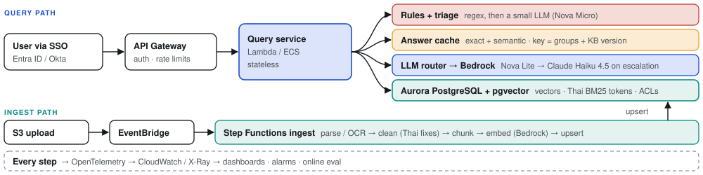

# Production Architecture — Enterprise Knowledge & Support Agent

**Scope:** the Task 1 prototype in production for **5,000 employees / 50,000 queries per day**, on AWS. 50k/day over a 9-hour workday is **~1.5 req/s average, 5–10 at peak**. An assumed corpus of ~20k documents is roughly 200k chunks. Scale is *small*; the real problems are **Thai quality, access control, and cost per answer**.

**Two quality gates** (from the Task 1 prototype) stop wrong answers: **Gate 1**, *before* the LLM: if search finds nothing similar enough (cosine < 0.80, re-tuned per embedding model), reply "not found" and skip the LLM call. **Gate 2**, *after* the LLM: code checks the answer is marked answerable, has confidence ≥ 0.6, and cites only real retrieved chunks. If it fails, escalate to Haiku; if that also fails, reply "not found" and log the question.

## 1. Cost vs. latency

| Layer | Choice | Why (rejected alternative) |
|---|---|---|
| **Embeddings** | **Cohere Embed Multilingual** on Bedrock (≈ $0.10 / 1M tokens) | Managed and multilingual. Queries cost about $0.2/day; re-embedding the whole corpus costs a few dollars. *(Titan V2: cheaper but weaker multilingual. Self-hosted bge-m3: a GPU to run.)* **Final pick by our Thai eval:** recall@5 must beat the prototype's e5 baseline. |
| **Vector DB** | **Aurora PostgreSQL + pgvector (HNSW)** | 200k–1M vectors is easy for pgvector. Vectors, keyword tokens, registry and **ACLs in one SQL query** (§3); one DB to operate. *(OpenSearch Serverless: capacity floor plus a second store. Pinecone: data leaves the account.)* |
| **Keyword search** | `tsvector` over **pythainlp-pre-tokenised** text | Postgres can't segment Thai, so we tokenise at ingest. Hybrid search + RRF stays as in the prototype. |
| **LLM** | **Router:** Nova Micro → **Nova Lite** → **Claude Haiku 4.5** on escalation | Cost and reasoning below. |

**LLM cost / month** (list prices Nov 2026, verify on the Bedrock pricing page). **How we count:** 50k questions/day → **45k triage calls** → **32k answer calls** (the rest are cache hits, refusals, Gate-1 fallbacks). Tokens per call: triage 600 in / 80 out, answer 2,400 in / 250 out. **Cost = calls × cost per call × 30 days.**

| Model | Price / 1M tokens (in / out) | Cost per call | Role |
|---|---|---|---|
| Nova Micro | $0.035 / $0.14 | triage ≈ $0.00003 | triage |
| Nova Lite | $0.06 / $0.24 | answer ≈ $0.0002 | most answers |
| Claude Haiku 4.5 | $1 / $5 | triage ≈ $0.0010 · answer ≈ $0.0037 | hard or high-risk answers |

| Option | Math per day | Month |
|---|---|---|
| Haiku for everything | 45k × $0.0010 + 32k × $0.0037 ≈ $163 | ≈ $4,900 |
| Nova only | 45k × $0.00003 + 32k × $0.0002 ≈ $8 | ≈ $240 |
| **Router (chosen):** Nova, Haiku on ~15% of answers | $8 + 4.8k × ~$0.0035 extra ≈ $25 | **≈ $750** |

**Why the router:** most questions are simple, so a small model is enough. Haiku (~20× the price) is used only when Gate 2 rejects the Nova answer or the topic is high-risk: **~6× cheaper** than Haiku for everything. **Final choice by our Thai test:** if Nova Lite scores about as well as Haiku, keep the router; otherwise use a stronger default model. *Assumes no prompt caching (our ~700-token prompt is below Bedrock's 4,096-token minimum on Haiku) · Thai token counts still to be measured · infra adds low hundreds of $/month.*

**Caching** (checked in this order):
- **No LLM** for rule refusals, greetings and Gate-1 fallbacks.
- **Exact answer cache:** key = normalised question + user's groups + **knowledge-base (KB) version**. HR questions repeat a lot.
- **Semantic cache:** reuse an answer when a past question is ≥ 0.95 cosine, with the same groups and KB version.
- Any document update bumps the KB version and clears both caches.
- **Bedrock prompt caching:** only once the fixed prompt passes the model's minimum size.

**Speed target:** 95% of answers start showing within **4 s** (p95), streamed word by word. Rough time per step: rules < 5 ms · cache ~10 ms · triage ~0.3 s and query embedding ~0.1 s (run **at the same time**) · search ~30 ms · first word of the answer < 1 s.

## 2. Evaluation framework

| Metric | Offline — CI gate before every change | Online — production |
|---|---|---|
| **Retrieval precision / recall** | Golden set of 300–500 real questions (e.g. from the fallback log), answered by subject-matter experts (SMEs) with labelled docs: **recall@k, precision@k, MRR**. | An LLM judge marks retrieved chunks relevant or not on a 2–5% sample. The golden set grows monthly. |
| **Accuracy** | Answer vs. SME reference, scored by an **LLM judge**. The judge is checked against ~100 human labels (κ ≥ 0.7) before we trust it. | Same judge daily · 👍/👎 · weekly human review of 50 answers, stratified by risk. |
| **Hallucination rate** | **Claim-level faithfulness:** split each answer into claims and check each against its cited chunks. Rate = % of answers with ≥ 1 unsupported claim. Citation validity 100%. | Same on the sample. Alarm above the release baseline. |
| **Guardrails** | Attack set (EN + TH) **plus a benign set**, to measure missed attacks *and* over-refusal. | Refusal rate by reason; rephrase rate after a refusal. |

*Metrics, looking at the top k search results (k = 4 in the prototype): **recall@k** = share of the right docs found in the top k · **precision@k** = share of the top k that is relevant · **MRR** = average of 1 ÷ rank of the first right doc (1.0 = always ranked first).*

**Release rule:** a change goes live only if no single metric gets worse than an agreed limit. Checking each metric on its own catches problems that one overall score can hide.

## 3. Security & governance — RBAC in the retrieval layer

- **Identity from SSO, never from the browser.** Cognito (linked to Entra ID/Okta) gives a token with the user's groups.
- **Every chunk carries its access rules**, copied from the source system at ingest: `allowed_groups`, `classification`, `owner`.
- **Filter inside the search query**, so blocked chunks are never scored, cached or sent to the LLM:
  `WHERE allowed_groups && :groups AND class_rank <= :clearance ORDER BY embedding <=> :q LIMIT 20`
- **Second lock:** the database itself also checks access on every row (Postgres Row-Level Security), so even a bug in our code can't show executive docs. Executive docs are stored **separately**, so searches skip docs the user can't see.
- **No side leaks + governance:** caches are keyed by groups, logs keep doc IDs only, an **audit log** records who opened executive docs, and every doc has an owner; confidential uploads need approval.

## 4. Code structure, observability, D2 handover

**Code:** one repo, deployed with AWS CDK: `core/` (search, guardrails, prompts) · `api/` · `ingest/` · `eval/` (test set + CI check) · `infra/` · `runbooks/`. Every answer is logged with the exact **prompt, model and index version** it used, so it can be reproduced. Models are pinned to a fixed version, never `-latest`.

| Need | How |
|---|---|
| **Logs + tracing** | One JSON log per request (trace ID, status, **reason**, scores, doc IDs, model, latency) → CloudWatch. OpenTelemetry → X-Ray, one span per step. The **trace ID is shown in the UI**, so each complaint maps to one request. |
| **Performance** | Dashboard: p95 per step, error rate, $/day, cache hit %, fallback rate **by reason**. Alarms: p95 > 5 s, errors > 2%, fallbacks +50% week-on-week, cost over budget. |
| **Quality** | Online eval on the same dashboard. Fallback log → backlog for document owners. |
| **RCA (Root Cause Analysis)** | `reason` + spans point to the broken part: more `low_retrieval_score` → check the index; more `invalid_citations` → check the model. A **replay tool** re-runs any request on the same versions. |
| **Safe changes** | Eval gate → shadow traffic (the new version runs alongside the old one on real requests; only the old one's answers are shown) → 5% canary (only 5% of users get it first) → full rollout; feature flags for quick rollback. |

**D2 handover:** a runbook per alarm (symptom → check → fix → escalate) · dashboard guide · SLOs (99.5% uptime, p95 < 4 s, faithfulness ≥ 95%) · escalation contacts · known issues · how-tos (add a doc, rotate keys, change thresholds, roll back). **Rule:** every new incident ends with a new runbook entry.

<small>**AWS terms** (same design maps to Azure/GCP): **Lambda** run code on demand, no servers · **ECS** run containers · **API Gateway** API front door · **S3** file storage · **EventBridge** "file uploaded" events · **Step Functions** workflows with retries · **Aurora PostgreSQL** managed Postgres; **pgvector** vector search · **Bedrock** one API for many AI models (≈ Azure OpenAI): **Nova Micro/Lite** small Amazon LLMs, **Claude Haiku 4.5** Anthropic's fast model, **Cohere Embed** embeddings · **Cognito** login via company SSO · **CloudWatch** logs, metrics, alarms · **X-Ray** traces · **OpenTelemetry** open tracing standard.</small>
